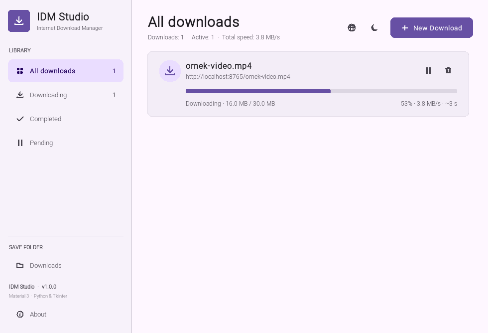
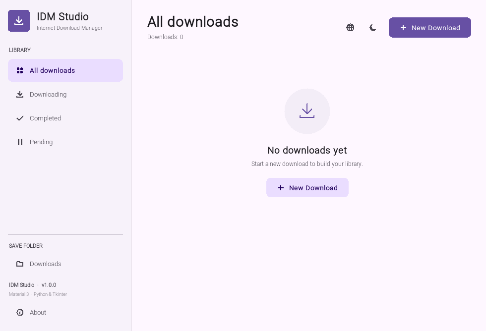
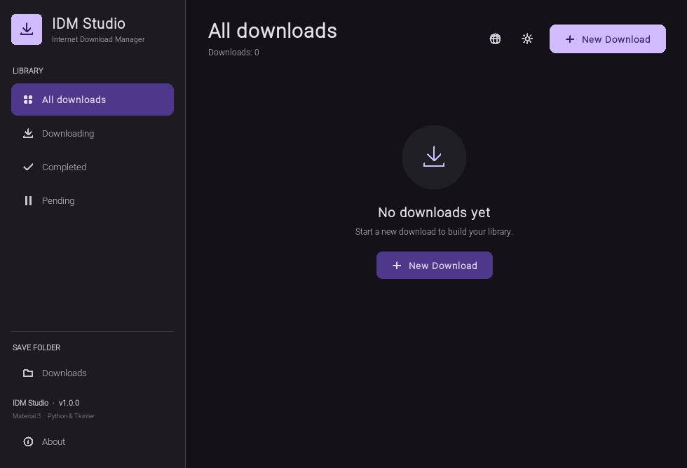
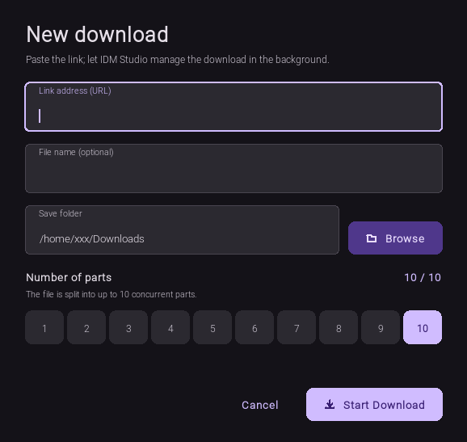

<p align="center">
  
</p>

<h1 align="center">IDM Studio</h1>

<p align="center">
  <a href="README.md">Türkçe</a> · <b>English</b>
</p>

<p align="center">
  <b>A Material 3-inspired, multi-connection desktop download manager</b><br>
  Python 3.10+ · Tkinter · Zero third-party dependencies in the core · 16 languages
</p>

<p align="center">
  <a href="https://www.python.org/"></a>
  
  
  
  <a href="LICENSE"></a>
</p>

<p align="center">
  IDM Studio downloads large files over multiple connections, lets you pause and resume downloads exactly where
  they left off, and shows the whole process through live statistics.<br>
  It supports HTTP/HTTPS, FTP/FTPS, HLS, and BitTorrent sources, and its interface is inspired by Material Design 3.
</p>

> **In short:** 1–10 concurrent segments, safe pause/resume, automatic recovery, scheduled downloads,
> automatic retry, clipboard link capture, system tray, light/dark themes, a 16-language interface,
> ready-to-use Linux packages, and a Windows executable.

## Contents

- [Screenshots](#screenshots)
- [Highlights](#highlights)
- [Quick start](#quick-start)
- [Installation](#installation)
- [Usage](#usage)
- [Keyboard shortcuts](#keyboard-shortcuts)
- [Project structure](#project-structure)
- [How it works](#how-it-works)
- [Building packages](#building-packages)
- [Troubleshooting](#troubleshooting)
- [Known limitations](#known-limitations)
- [Contributing](#contributing)
- [License](#license)

## Screenshots

### Live download statistics

<p align="center">
  
  <br>
  <sub>The active download card updates speed, percentage, downloaded/total size, and estimated time remaining in real time.</sub>
</p>

### Light and dark themes

<table align="center">
  <tr>
    <td align="center" width="50%">
      
      <br>
      <sub><b>Light theme</b></sub>
    </td>
    <td align="center" width="50%">
      
      <br>
      <sub><b>Dark theme</b></sub>
    </td>
  </tr>
</table>

<p align="center">
  <sub>Switch themes with a single click on the sun/moon icon in the top bar; your choice is restored on the next launch.</sub>
</p>

### New download dialog

<p align="center">
  
  <br>
  <sub>Enter a link, an optional filename, a save folder, and a segment count from 1 to 10 — all in one dialog.</sub>
</p>

## Highlights

### Fast and resilient download engine

- **Multi-part downloads:** Large files are split into 1–10 concurrent segments. The default is 4 connections, and the last selection is remembered.
- **Server capability check:** Before starting, a `HEAD` request and a 1-byte `Range` probe verify whether the server really supports ranged downloads.
- **Pause / resume:** Partial data is kept in `.idm-*.part` files; resuming requests only the missing byte range.
- **Automatic recovery:** If the app closes, unfinished downloads return in a paused state on the next launch.
- **Safe merging:** Segments are merged into a temporary file first and then moved into place with `os.replace`, so an interrupted merge cannot corrupt an existing file.
- **Single-stream fallback:** If the server does not support `Range` or the file is too small to split, the download completes over a single connection.
- **Clear errors:** HTTP errors, timeouts, connection drops, and disk errors are shown as plain-language messages; failed downloads can be retried from the card.
- **Automatic retry:** Choose 0–10 attempts in the new download dialog. Failed downloads are retried automatically with increasing backoff; the card shows the attempt count.

### Source protocols

- **HTTP / HTTPS:** Multi-part, ranged downloads with exact resume support.
- **FTP / FTPS:** Authenticated downloads through `ftplib`, with segmented resume via the `REST` command when the server supports it. Both explicit (`AUTH TLS`) and implicit (port 990) FTPS are supported.
- **HLS (.m3u8):** Resolves master/media playlists, relative URLs, AES-128, `EXT-X-BYTERANGE`, `EXT-X-MAP`, live playlist refresh, and alternate audio renditions, then merges the result.
- **BitTorrent (.torrent / magnet):** Dependency-free bencode, HTTP/HTTPS/UDP trackers, DHT, PEX, BEP 9 magnet metadata, MSE/PE peer encryption, IPv4/IPv6 peers, SHA-1 piece verification, multi-file torrents, and post-download seeding.
- **Video platforms:** Optional `yt-dlp` integration for YouTube, Vimeo, and similar sites. If it is not installed, the app shows a clear error.

### Scheduling, clipboard, and system tray

- **Scheduled downloads:** Enter a start time as `YYYY-MM-DD HH:MM` or just `HH:MM`; due downloads start automatically while the app is running.
- **Clipboard link capture:** When enabled in Settings, HTTP/HTTPS, FTP/FTPS, or `.torrent` paths copied to the clipboard are offered through a snackbar; downloads never start automatically.
- **System tray:** On Windows it uses the native Win32 `Shell_NotifyIcon` API with no extra packages. Closing the window keeps downloads running in the background; the tray menu can show/hide the window, start a new download, pause/resume all, and exit. On other platforms the same features work when `pystray` + `Pillow` are installed.

### Material 3 interface

- **Light and dark themes:** Switch between Material 3 color palettes with a single click.
- **Live statistics:** Speed, percentage, size, time remaining, and status update continuously on each card.
- **Library filters:** Sidebar views for all downloads, active downloads, completed downloads, and pending downloads.
- **Modern components:** Rounded cards, Canvas-drawn vector icons, snackbar notifications, custom text fields, and a slim scrollbar.
- **Card actions:** Pause, resume, cancel, open the folder, remove from the list, or double-click a completed file to open it.
- **About dialog:** Version, developer, and contact information; press `F1` to open it.

### Language, persistence, and everyday use

- **16-language interface:** Turkish, English, German, French, Italian, Portuguese, Spanish, Azerbaijani, Turkmen, Russian, Ukrainian, Finnish, Swedish, Japanese, Korean, and Chinese. Switch languages from the globe icon in the top bar or with `Ctrl+L`.
- **System language detection:** If no preference has been saved yet, a supported language is selected from the system locale.
- **Remembered preferences:** Theme, language, last save folder, segment count, retry count, and clipboard/tray preferences are stored in `~/.config/idm-studio/state.json`.
- **Offline translations:** All interface strings are embedded in the application, so the UI is complete even when the system does not have the matching locale installed.

## Quick start

The core only requires **Python 3.10+** and **Tkinter**. You can optionally install `yt-dlp` for
video platforms, `pystray` + `Pillow` for the system tray outside Windows, and `cryptography` to
accelerate AES-128 HLS decryption (pure Python AES is used when it is absent). **FFmpeg** is required
on the system for formats that need separate audio/video streams merged. If you use the ready-made
Windows `.exe`, Python does not need to be installed; see [Windows (.exe)](#windows-exe).

```bash
cd internet-download-manager
./run.sh
```

Or launch it directly with Python:

```bash
python3 main.py
```

If `run.sh` is not executable:

```bash
chmod +x run.sh
./run.sh
```

> On Linux, Tkinter may be a separate package. See the [Installation](#installation) section for one-line
> install commands. The application requires a graphical desktop session; when running over SSH, use
> X11 forwarding or a virtual display.

## Installation

### Requirements

| Component | Requirement |
| --- | --- |
| Python | 3.10 or newer |
| GUI toolkit | Tkinter (bundled with official Windows/macOS Python installers) |
| Operating system | Linux, Windows, or macOS |
| Third-party Python packages | None for the core. Optional `yt-dlp` for video platforms; optional `pystray` + `Pillow` for the system tray outside Windows. |

### Tkinter on Linux

Debian / Ubuntu / Linux Mint:

```bash
sudo apt install python3-tk
```

Fedora:

```bash
sudo dnf install python3-tkinter
```

Arch / Manjaro:

```bash
sudo pacman -S tk
```

### Run from source

Clone the repository or download it as a ZIP, then from the project folder:

```bash
./run.sh
```

or:

```bash
python3 main.py
```

### Linux packages

Linux packages are produced with the scripts under `packaging/`; the generated outputs are written to `dist/`.

| Package | File | Notes |
| --- | --- | --- |
| Debian / Ubuntu | `dist/idm-studio_1.1.0_all.deb` | Installs the `python3-tk` and `xdg-utils` dependencies automatically and adds a desktop menu entry; `yt-dlp` is recommended for video platforms. |
| AppImage | `dist/IDM-Studio-1.1.0-x86_64.AppImage` | Bundles the Python and Tkinter runtime; when installed at build time, `yt-dlp` and `pystray` + `Pillow` for the Linux tray are bundled too. No installation required. |

#### Debian / Ubuntu (.deb)

```bash
sudo apt install ./dist/idm-studio_1.1.0_all.deb
idm-studio
```

After installation, the application also appears in the desktop menu as **IDM Studio**.

#### AppImage

```bash
chmod +x dist/IDM-Studio-1.1.0-x86_64.AppImage
./dist/IDM-Studio-1.1.0-x86_64.AppImage
```

If FUSE is not available:

```bash
APPIMAGE_EXTRACT_AND_RUN=1 ./dist/IDM-Studio-1.1.0-x86_64.AppImage
```

### Windows (.exe)

The single-file Windows executable in `dist/` contains the Python and Tkinter runtime, so Python does not need to be installed to run it. If `yt-dlp` was installed at build time, video-platform support is embedded too. FFmpeg must still be available on `PATH` for formats that require separate audio/video streams to be merged.

```powershell
.\dist\IDM-Studio-1.1.0-windows-x86_64.exe
```

To rebuild it:

```powershell
powershell -NoProfile -ExecutionPolicy Bypass -File packaging\build_windows.ps1
```

The build requires Python 3.10+ and PyInstaller; the application icon is included in the repository. If the optional `yt-dlp` package is installed, the script bundles video support automatically; FFmpeg is not bundled. The output is written to `dist/IDM-Studio-1.1.0-windows-x86_64.exe`.

### macOS (.app / .dmg)

PyInstaller can only produce macOS applications on macOS, so no prebuilt macOS package is included in the repository. On a Mac with Python 3.10+, Tkinter, and PyInstaller installed:

```bash
chmod +x packaging/build_macos.sh
./packaging/build_macos.sh
```

The script writes `dist/IDM-Studio-1.1.0-macos-<arch>.app.zip` and `.dmg`; it bundles `yt-dlp`, `pystray`, and `Pillow` when they are installed. Because the app is unsigned/ad-hoc signed, Gatekeeper may warn on first launch; approve it with **System Settings → Privacy & Security → Open Anyway**.

### Verify package integrity

`SHA256SUMS` covers the Linux packages, the Windows `.exe`, and any macOS archives.

```bash
cd dist
sha256sum -c SHA256SUMS
```

To verify a single file on Windows:

```powershell
Get-FileHash .\dist\IDM-Studio-1.1.0-windows-x86_64.exe -Algorithm SHA256
```

## Usage

### Your first download

1. Click **New Download** in the top-right corner (or press `Ctrl+N`).
2. Paste an `http://`, `https://`, `ftp://`, or `ftps://` link, a `.torrent` file path, or an HLS `.m3u8` URL. If the scheme is missing, `https://` is added automatically.
3. Change **Source type** if needed; the default **Auto detect** option decides from the scheme and extension.
4. Optionally change the filename and save folder.
5. Choose the number of segments (1–10), the automatic retry count (0–10), and an optional start time.
6. Click **Start Download**. A scheduled download waits in the **Scheduled** state until its time arrives.

### Download card

Use the buttons on a download card to pause, resume, cancel, open the folder of a completed file,
or remove the entry from the list. Double-clicking a completed card opens the file with the default application.

When a download fails, a **Retry** button appears on the card. If automatic retry is enabled, the task
keeps retrying while attempts remain; the card shows **Retrying** and the attempt count. Canceling a
download removes its temporary part files; pausing a download keeps them for later.

### Settings and system tray

Use **Settings** in the bottom-left corner to enable clipboard link capture, close-to-tray behavior,
and the default automatic retry count. The tray icon in the top bar or **Minimize to system tray**
hides the window while downloads continue in the background. The tray menu can restore the window,
start a new download, pause/resume all downloads, or exit the app.

### Language and theme

- The globe icon in the top bar (or `Ctrl+L`) opens the 16-language menu.
- The sun/moon icon switches between the light and dark themes.
- Changes apply instantly: all windows, card states, units, and dates adapt to the new language.

### About

The **About** item in the bottom-left corner (or `F1`) opens a window with version, developer,
and contact information.

## Keyboard shortcuts

| Shortcut | Action |
| --- | --- |
| `Ctrl+N` | New download dialog |
| `Ctrl+L` | Language menu |
| `Esc` | Close the new download dialog |
| `Enter` | Start the download while the URL field is focused |
| `F1` | About dialog |

## Project structure

```text
internet-download-manager/
├── main.py                  # Entry point and Tkinter check
├── idm_studio/
│   ├── app.py               # Main window, theme, filters, scheduler, tray lifecycle
│   ├── downloader.py        # HTTP/FTP/HLS/torrent engine and retry logic
│   ├── torrent.py           # BitTorrent client (magnet, DHT, PEX, tracker, MSE, seeding)
│   ├── hls.py               # HLS playlists, AES-128, byte ranges, live refresh
│   ├── tray.py              # Win32 Shell_NotifyIcon and optional pystray tray
│   ├── cards.py             # Canvas-rendered download cards
│   ├── dialogs.py           # New download, settings, and about dialogs
│   ├── i18n.py              # Interface strings for 16 languages and language selection
│   ├── widgets.py           # Material buttons, entries, snackbar, scrollbar…
│   ├── draw.py              # Rounded shapes and vector icons
│   ├── theme.py             # Material 3 color palette and fonts
│   ├── utils.py             # Formatting, scheduling, and file helpers
│   └── __init__.py          # Version information
├── packaging/
│   ├── build_deb.sh         # Debian package build
│   ├── build_appimage.sh    # PyInstaller + AppImage build
│   ├── build_all.sh         # Builds Linux packages and includes Windows/macOS checksums if present
│   ├── build_windows.ps1    # Single-file Windows .exe build
│   ├── build_macos.sh       # macOS .app and .dmg build (macOS only)
│   ├── idm-studio.desktop   # Desktop shortcut
│   ├── idm-studio.svg       # Vector application icon
│   ├── idm-studio-256.png   # PNG application icon
│   └── idm-studio.ico       # Windows application icon
├── docs/
│   └── screenshots/         # README screenshots (Turkish and English)
├── dist/                    # Generated .deb, AppImage, Windows .exe, and SHA256SUMS
├── requirements.txt         # No core dependencies; optional packages are listed
├── run.sh                   # Quick launch script
├── LICENSE                  # MIT license
├── README.md                # Turkish README
└── README.en.md             # English README
```

## How it works

### 1. Source discovery and protocol selection

`DownloadTask` selects HTTP, FTP, HLS, BitTorrent, or video-platform mode from the URL scheme and
extension. In HTTP mode it first sends a `HEAD` request to learn the file size, filename
(`Content-Disposition`), content type, and final redirected URL. It then sends `Range: bytes=0-0` to
verify that the server really returns `206 Partial Content`. FTP mode uses `SIZE` and `REST`, HLS mode
reads the playlist, and BitTorrent mode reads bencode and tracker metadata.

### 2. Splitting and downloading

If the HTTP/FTP server supports ranged downloads and the file is large enough, the content is split into
at most 10 segments based on the selected connection count. Each segment is downloaded in its own thread
with `Range` or FTP `REST` and written to disk in 256 KB chunks. HLS segments are merged in order;
BitTorrent pieces are verified with SHA-1 and missing pieces are fetched from other peers. Files under
1 MB, or servers without ranged-download support, use a single stream.

### 3. Pausing, recovery, and retry

Each segment is stored in the download folder as `.idm-<task-id>.part<N>`. Pausing preserves these files;
resuming reads the current size and continues with `Range: bytes=current-...`. BitTorrent additionally
stores piece state in a `.torrent.state` file. If the app closes, the task list is restored from
`state.json`; unfinished and scheduled tasks are preserved. When automatic retry is enabled, failed tasks
are retried with increasing backoff (1, 2, 4, … seconds, capped at 15 seconds).

### 4. Merging

Completed segments are merged into a temporary file named `.idm-<task-id>.merged`. When merging succeeds,
the file is moved to its destination with `os.replace`. If the app closes or the download is canceled during
merging, the destination file is left untouched.

### 5. Interface and persistence

All network operations run on background threads. Task updates reach the main Tkinter thread through a
`queue`, so the interface never freezes. Tray actions are also queued; the tray thread never touches Tkinter
directly. The download list, theme, language, last folder, segment count, retry count, and tray/clipboard
preferences are written atomically to `~/.config/idm-studio/state.json`.

### 6. Dependency-free core

The core download engine and interface use only the Python standard library and Tkinter. FTP uses `ftplib`,
HLS uses `urllib`, and BitTorrent is implemented in the bundled `torrent.py` module. Two optional
extensions exist:

- `pip install yt-dlp` for video-platform support
- `pip install pystray pillow` for the system tray outside Windows

If these packages are missing, the rest of the app works normally; the relevant feature shows a clear
error or an "unavailable" message. `requirements.txt` is therefore informational only.

## Building packages

To build both packages on a Debian/Ubuntu build host:

```bash
./packaging/build_all.sh
```

To build only one Linux package:

```bash
./packaging/build_deb.sh
./packaging/build_appimage.sh
```

To build the single-file Windows `.exe`:

```powershell
powershell -NoProfile -ExecutionPolicy Bypass -File packaging\build_windows.ps1
```

To build the macOS `.app` and `.dmg` (macOS only):

```bash
./packaging/build_macos.sh
```

- The `.deb` package is produced with `dpkg-deb` only and does not require root privileges.
- The AppImage bundles the Python/Tkinter runtime using PyInstaller. If `yt-dlp` and `pystray` + `Pillow`
  for the Linux tray are installed on the build host, they are included as well.
- The Windows build uses PyInstaller to produce a single `.exe`; `yt-dlp` is bundled when installed.
  FFmpeg is not bundled because of size and licensing; install it separately.
- To include Linux tray support in the AppImage, install `pystray` + `Pillow` on the build host. On headless
  servers, use `xvfb-run -a ./packaging/build_all.sh`; otherwise `pystray` may be omitted.
- If Tkinter or PyInstaller is missing on the build host, `build_appimage.sh` downloads the required packages
  into `.build/` and sets up a local toolchain on Debian/Ubuntu; no `sudo` is required. An internet connection
  is needed, or you can install the system packages with `sudo apt install python3-tk pyinstaller`. Some
  Debian/Ubuntu releases also require `libpython3.11` (or the matching `libpython3.12`) for PyInstaller.
- The macOS build runs only on macOS; PyInstaller cannot cross-compile applications. Outputs are written as
  `dist/IDM-Studio-<version>-macos-<arch>.app.zip` and `.dmg`.
- Outputs and SHA256 checksums are created under `dist/`. Linux, Windows, and any macOS outputs are listed
  in the same `SHA256SUMS` file.

## Troubleshooting

| Problem | Solution |
| --- | --- |
| `ModuleNotFoundError: No module named 'tkinter'` | Install the Tkinter package for your distribution: `sudo apt install python3-tk`, `sudo dnf install python3-tkinter`, or `sudo pacman -S tk`. |
| `Grafik ekranı bulunamadı (DISPLAY değişkeni yok)` | Run the app in a graphical desktop session; when using SSH, try `ssh -X` or `xvfb-run`. |
| AppImage will not start | Make the file executable: `chmod +x dist/IDM-Studio-1.1.0-x86_64.AppImage`. On FUSE errors, launch it with `APPIMAGE_EXTRACT_AND_RUN=1`. |
| AppImage build cannot find `libpython3.11.so.1.0` | Install `sudo apt install libpython3.11` (or `libpython3.12` for your Python version) and rerun the build. |
| AppImage build says `objdump is required` | Install `sudo apt install binutils` and rerun the build. |
| "The server does not support ranged downloads" | Set the segment count to 1 and download over a single connection. The server may not support the `Range` header. |
| Download stays at 0 B/s | The server may have closed the connection or the network may be down. Use the **Retry** button on the card or enable automatic retry. |
| Video platform download fails | Install the optional package with `pip install yt-dlp` and make sure FFmpeg is on `PATH` for separate audio/video merging. DRM-protected streams are not supported. |
| Magnet links do not work | Check that the link has a valid `xt=urn:btih:` value and that a tracker or DHT node is reachable; if metadata cannot be fetched, use a `.torrent` file or HTTP(S) URL. |
| Torrent cannot find peers | Make sure the torrent has active trackers and open ports. A firewall may be blocking outbound TCP connections. |
| System tray does not appear | Windows has built-in support. On Linux/macOS, install `pip install pystray pillow`; otherwise closing the window exits the app. |
| Windows `.exe` triggers SmartScreen | The executable is unsigned, so Windows may warn. Choose **More info → Run anyway**, or run the application from source. |
| Settings are corrupted / old downloads are missing | Back up and delete `~/.config/idm-studio/state.json`; the app will start with a clean state. |

## Known limitations

- There is no browser extension; links can be captured from the clipboard or entered manually.
- Magnet links, DHT, PEX, and post-download seeding are supported. Each task seeds for 60 seconds by default; pause or cancel ends seeding early.
- The BitTorrent client supports HTTP/HTTPS/UDP trackers, `peers6` (IPv6) peers, and MSE/PE peer encryption. DHT and PEX are disabled for private torrents.
- HLS supports AES-128, `#EXT-X-BYTERANGE`, live playlist refresh, and alternate audio renditions. DRM and `SAMPLE-AES`/`KEYFORMAT` content are unsupported. Merging alternate audio into one file requires FFmpeg; without it, video and audio are saved as separate files.
- Video-platform integration depends on the optional `yt-dlp` package; without it, only HLS/direct links are available.
- If an FTP server does not support the `REST` command, the client falls back to a single stream and re-reads from the start to finish a resumed download. Both explicit (`AUTH TLS`) and implicit (port 990) FTPS are supported.
- The system tray is built in on Windows. Linux and macOS require `pystray` + `Pillow`, and tray behavior may vary by desktop environment.
- The ready-made `.deb` and AppImage packages target Linux, while the single-file `.exe` targets Windows.
  A macOS `.app`/`.dmg` can only be produced on a Mac with `packaging/build_macos.sh`; no prebuilt macOS package is included.
- The Windows `.exe` is unsigned, so SmartScreen or antivirus software may show a warning. You can run the
  application from source or build your own copy.
- The interface is built with Tkinter, so small visual differences may appear across platforms.

## Contributing

Contributions are welcome.

1. Fork the repository and create a new branch.
2. Make your change in the existing code style.
3. If you add interface text, add the corresponding translations to the language dictionaries in `idm_studio/i18n.py`.
4. Test the interface manually, then open a pull request with a clear commit message.

Quick syntax check:

```bash
python3 -m compileall idm_studio main.py
```

## License

This project is released under the MIT License; see the [`LICENSE`](LICENSE) file for details.

You are responsible for respecting the copyrights of the content you download and the terms of service
of the target server.

---

<p align="center">
  <sub>Developer: <b>Bekir Alişoğlu</b> · <a href="mailto:alisoglu@yahoo.com">alisoglu@yahoo.com</a></sub>
</p>
