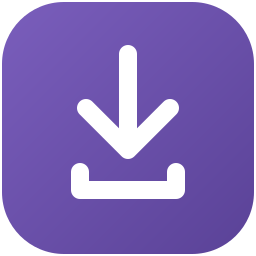
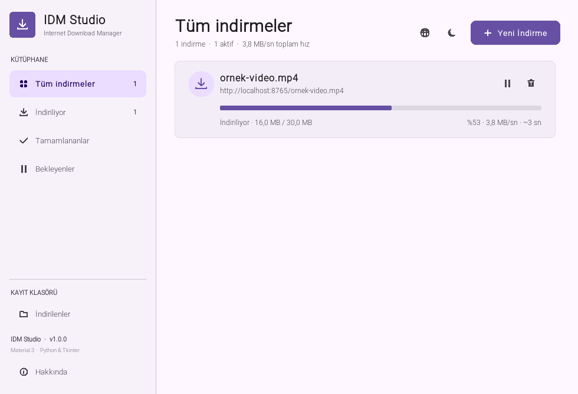
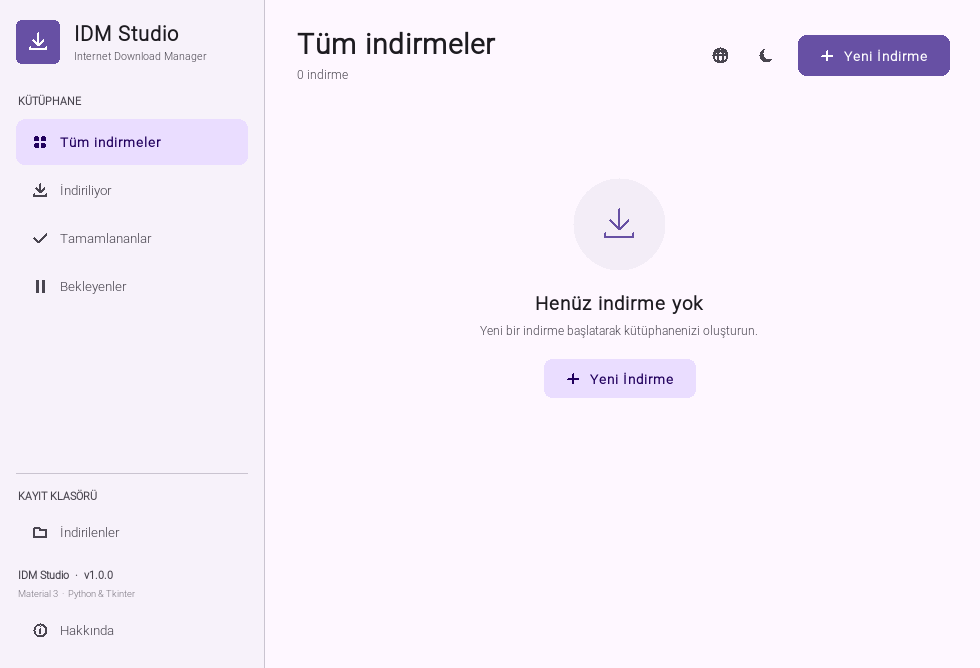
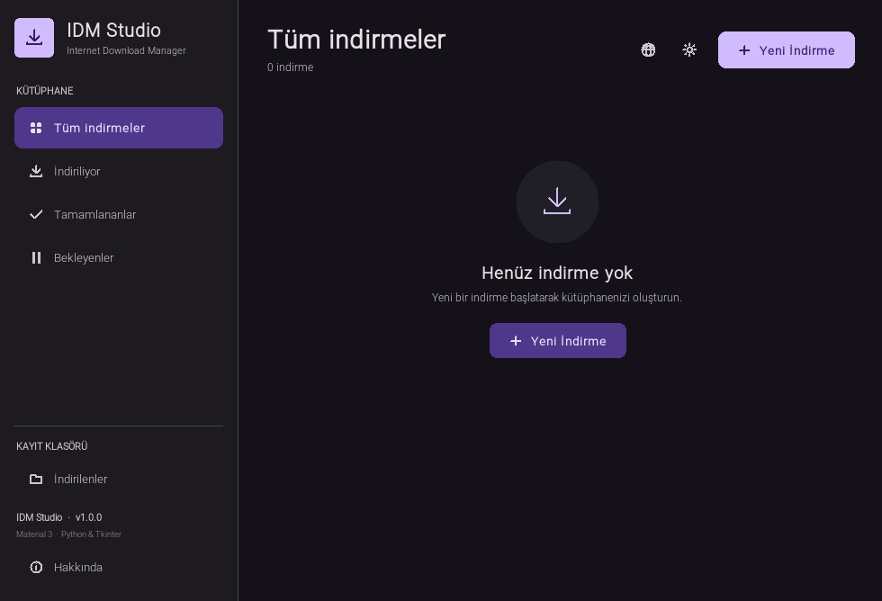
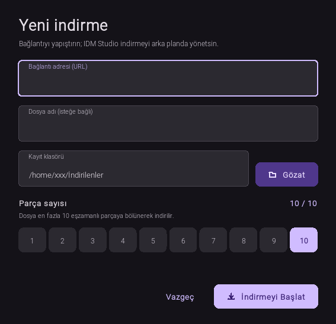

<p align="center">
  
</p>

<h1 align="center">IDM Studio</h1>

<p align="center">
  <b>Türkçe</b> · <a href="README.en.md">English</a>
</p>

<p align="center">
  <b>Material 3 görünümlü, çok bağlantılı masaüstü indirme yöneticisi</b><br>
  Python 3.10+ · Tkinter · Çekirdekte sıfır harici bağımlılık · 16 dil
</p>

<p align="center">
  <a href="https://www.python.org/"></a>
  
  
  
  <a href="LICENSE"></a>
</p>

<p align="center">
  IDM Studio; büyük dosyaları birden fazla bağlantıyla indiren, indirmeleri duraklatıp kaldığı yerden sürdürebilen
  ve tüm süreci canlı istatistiklerle gösteren bir masaüstü uygulamasıdır.<br>
  HTTP/HTTPS, FTP/FTPS, HLS ve BitTorrent kaynaklarını destekler; arayüzü Material Design 3 paletinden ilham alır.
</p>

> **Kısaca:** 1–10 arası eşzamanlı parça, güvenli duraklat/devam, otomatik kurtarma, zamanlanmış indirmeler,
> otomatik yeniden deneme, panodan bağlantı yakalama, sistem tepsisi, açık/koyu tema, 16 dilli arayüz
> ve hazır Linux paketleri ile Windows çalıştırılabilir dosyası.

## İçindekiler

- [Ekran görüntüleri](#ekran-görüntüleri)
- [Öne çıkan özellikler](#öne-çıkan-özellikler)
- [Hızlı başlangıç](#hızlı-başlangıç)
- [Kurulum](#kurulum)
- [Kullanım](#kullanım)
- [Klavye kısayolları](#klavye-kısayolları)
- [Proje yapısı](#proje-yapısı)
- [Nasıl çalışır?](#nasıl-çalışır)
- [Paket üretimi](#paket-üretimi)
- [Sorun giderme](#sorun-giderme)
- [Bilinen sınırlamalar](#bilinen-sınırlamalar)
- [Katkı](#katkı)
- [Lisans](#lisans)

## Ekran görüntüleri

### İndirme sırasında canlı istatistikler

<p align="center">
  
  <br>
  <sub>Aktif indirme kartında hız, yüzde, indirilen/toplam boyut ve tahmini kalan süre anlık olarak güncellenir.</sub>
</p>

### Açık ve koyu tema

<table align="center">
  <tr>
    <td align="center" width="50%">
      
      <br>
      <sub><b>Açık tema</b></sub>
    </td>
    <td align="center" width="50%">
      
      <br>
      <sub><b>Koyu tema</b></sub>
    </td>
  </tr>
</table>

<p align="center">
  <sub>Tema, üst çubuktaki güneş/ay simgesiyle tek tıkla değiştirilir ve tercih sonraki açılışta korunur.</sub>
</p>

### Yeni indirme penceresi

<p align="center">
  
  <br>
  <sub>Bağlantı, isteğe bağlı dosya adı, kayıt klasörü ve 1–10 arası parça sayısı tek pencerede seçilir.</sub>
</p>

## Öne çıkan özellikler

### Hızlı ve dayanıklı indirme motoru

- **Çok parçalı indirme:** Büyük dosyalar 1–10 eşzamanlı parçaya bölünür. Varsayılan 4 bağlantıdır; son seçilen değer hatırlanır.
- **Sunucu yeteneğini doğrulama:** İndirme başlamadan önce `HEAD` isteği ve 1 baytlık `Range` denemesiyle sunucunun aralıklı indirmeyi gerçekten destekleyip desteklemediği kontrol edilir.
- **Duraklat / devam ettir:** Kısmi veriler `.idm-*.part` dosyalarında tutulur; devam ederken yalnızca eksik bayt aralığı istenir.
- **Otomatik kurtarma:** Uygulama kapanırsa yarım kalan indirmeler bir sonraki açılışta duraklatılmış olarak geri gelir.
- **Güvenli birleştirme:** Parçalar önce geçici bir dosyada birleştirilir, ardından `os.replace` ile hedefe taşınır. Böylece yarım kalan birleştirme mevcut dosyanızı bozmaz.
- **Tek akışa geri dönüş:** Sunucu `Range` desteklemiyorsa veya dosya parçalamak için çok küçükse indirme tek bağlantıyla tamamlanır.
- **Anlaşılır hatalar:** HTTP hataları, zaman aşımı, bağlantı kopması ve disk hataları kullanıcıya sade mesajlarla gösterilir; hatalı indirmeler kart üzerinden yeniden denenebilir.
- **Otomatik yeniden deneme:** Yeni indirme penceresinde 0–10 arası deneme sayısı seçilebilir. Hata alan indirmeler artan bekleme süresiyle otomatik olarak yeniden denenir; kartta deneme sayısı gösterilir.

### Kaynak protokolleri

- **HTTP / HTTPS:** Çok parçalı, aralıklı ve kaldığı yerden devam eden indirme.
- **FTP / FTPS:** `ftplib` ile kimlik doğrulamalı indirme; sunucu destekliyorsa `REST` komutuyla parçalı devam. Açık (`AUTH TLS`) ve örtük (port 990) FTPS desteklenir.
- **HLS (.m3u8):** Master/medya oynatma listelerini çözer; AES-128, `EXT-X-BYTERANGE`, `EXT-X-MAP`, canlı liste yenileme ve alternatif ses parçalarını işler; parçaları tek dosyada birleştirir.
- **BitTorrent (.torrent / magnet):** Ek paket gerektirmeyen bencode, HTTP/HTTPS/UDP tracker, DHT, PEX, BEP 9 magnet meta verisi, MSE/PE eş şifrelemesi, IPv4/IPv6 eşler, SHA-1 parça doğrulaması, çok dosyalı torrent desteği ve indirme sonrası seeding.
- **Video platformları:** İsteğe bağlı `yt-dlp` kurulumuyla YouTube, Vimeo ve benzeri sitelerden video indirme. Kurulu değilse uygulama açıklayıcı bir hata gösterir.

### Zamanlama, pano ve sistem tepsisi

- **Zamanlanmış indirme:** Başlangıç zamanı `YYYY-AA-GG SS:DD` veya yalnızca `SS:DD` biçiminde girilebilir; zamanı gelen indirmeler uygulama açıkken otomatik başlar.
- **Panodan bağlantı yakalama:** Ayarlardan açıldığında panoya kopyalanan HTTP/HTTPS, FTP/FTPS veya `.torrent` yolu snackbar ile önerilir; otomatik indirme başlatılmaz.
- **Sistem tepsisi:** Windows'ta ek paket olmadan Win32 `Shell_NotifyIcon` API'siyle çalışır. Pencere kapatıldığında indirmeler arka planda sürer; tepsi menüsünden göster/gizle, yeni indirme, tümünü duraklat/sürdür ve çıkış yapılabilir. Diğer platformlarda `pystray` + `Pillow` kuruluysa aynı işlevler kullanılabilir.

### Material 3 arayüz

- **Açık ve koyu tema:** Material 3 renk paletleri arasında tek tıkla geçiş.
- **Canlı istatistikler:** Hız, yüzde, boyut, kalan süre ve durum bilgisi kartlarda anlık güncellenir.
- **Kütüphane filtreleri:** Tüm indirmeler, indiriliyor, tamamlananlar ve bekleyenler için sol kenar çubuğu.
- **Modern bileşenler:** Yuvarlatılmış kartlar, Canvas ile çizilmiş vektörel ikonlar, snackbar bildirimleri, özel metin alanları ve ince kaydırma çubuğu.
- **Kart eylemleri:** Duraklat, devam ettir, iptal et, klasörü aç, listeden kaldır veya tamamlanan dosyayı çift tıklayarak aç.
- **Hakkında penceresi:** Sürüm, geliştirici ve iletişim bilgileri; `F1` ile açılır.

### Dil, kalıcılık ve günlük kullanım

- **16 dilli arayüz:** Türkçe, İngilizce, Almanca, Fransızca, İtalyanca, Portekizce, İspanyolca, Azerice, Türkmence, Rusça, Ukraynaca, Fince, İsveççe, Japonca, Korece ve Çince. Dil, üst çubuktaki dünya simgesinden veya `Ctrl+L` ile değiştirilir.
- **Sistem dilini algılama:** Kayıtlı bir tercih yoksa sistem yerel ayarına uygun dil seçilir.
- **Hatırlanan tercihler:** Tema, dil, son kayıt klasörü, parça sayısı, yeniden deneme sayısı, pano ve tepsi tercihleri `~/.config/idm-studio/state.json` içinde saklanır.
- **Çevrimdışı çeviriler:** Tüm arayüz metinleri uygulamanın içine gömülüdür; sistemde ilgili dil paketi kurulu olmasa da arayüz eksiksiz görüntülenir.

## Hızlı başlangıç

Çekirdek için tek gereksinim **Python 3.10+** ve **Tkinter**'dır. Video platformları için isteğe bağlı
`yt-dlp`, Windows dışında sistem tepsisi için isteğe bağlı `pystray` + `Pillow`, AES-128 HLS çözümünü
hızlandırmak için isteğe bağlı `cryptography` kurabilirsiniz (paket yoksa saf Python AES kullanılır).
Ayrı ses/video akışlarının birleştirilmesi gereken formatlarda sistemde **FFmpeg** bulunmalıdır.
Windows'ta hazır `.exe` kullanacaksanız Python kurulumu gerekmez; [Windows (.exe)](#windows-exe)
bölümüne bakın.

```bash
cd internet-download-manager
./run.sh
```

Alternatif olarak doğrudan Python ile başlatın:

```bash
python3 main.py
```

`run.sh` çalışmıyorsa:

```bash
chmod +x run.sh
./run.sh
```

> Linux'ta Tkinter ayrı bir paket olabilir. Tek satırlık kurulum komutları için
> [Kurulum](#kurulum) bölümüne bakın. Uygulama grafik bir masaüstü oturumu gerektirir;
> SSH üzerinden çalıştırırken X11 yönlendirmesi veya sanal ekran kullanılmalıdır.

## Kurulum

### Gereksinimler

| Bileşen | Gereksinim |
| --- | --- |
| Python | 3.10 veya üzeri |
| Arayüz | Tkinter (Windows/macOS resmî Python kurulumlarıyla birlikte gelir) |
| İşletim sistemi | Linux, Windows veya macOS |
| Harici Python paketi | Çekirdek için yok. Video platformları için isteğe bağlı `yt-dlp`; Windows dışında sistem tepsisi için isteğe bağlı `pystray` + `Pillow`. |

### Linux'ta Tkinter

Debian / Ubuntu / Linux Mint:

```bash
sudo apt install python3-tk
```

Fedora:

```bash
sudo dnf install python3-tkinter
```

Arch / Manjaro:

```bash
sudo pacman -S tk
```

### Kaynaktan çalıştırma

Depoyu klonlayın veya ZIP olarak indirin, ardından proje klasöründe:

```bash
./run.sh
```

veya:

```bash
python3 main.py
```

### Linux paketleri

Linux paketleri `packaging/` altındaki scriptlerle üretilir; üretilen çıktılar `dist/` klasörüne yazılır.

| Paket | Dosya | Not |
| --- | --- | --- |
| Debian / Ubuntu | `dist/idm-studio_1.1.0_all.deb` | `python3-tk` ve `xdg-utils` bağımlılıklarını otomatik kurar, masaüstü menüsüne ekler; video platformları için `yt-dlp` önerilir. |
| AppImage | `dist/IDM-Studio-1.1.0-x86_64.AppImage` | Python ve Tkinter çalışma zamanını içinde taşır; derleme sırasında kuruluysa `yt-dlp` ve Linux tepsisi için `pystray` + `Pillow` da paketlenir. Kurulum gerektirmez. |

#### Debian / Ubuntu (.deb)

```bash
sudo apt install ./dist/idm-studio_1.1.0_all.deb
idm-studio
```

Kurulumdan sonra uygulama, masaüstü menüsünde **IDM Studio** adıyla da görünür.

#### AppImage

```bash
chmod +x dist/IDM-Studio-1.1.0-x86_64.AppImage
./dist/IDM-Studio-1.1.0-x86_64.AppImage
```

Sistemde FUSE yoksa:

```bash
APPIMAGE_EXTRACT_AND_RUN=1 ./dist/IDM-Studio-1.1.0-x86_64.AppImage
```

### Windows (.exe)

`dist/` altındaki tek dosyalık Windows çalıştırılabilir dosyası Python ve Tkinter çalışma zamanını içerir; çalıştırmak için Python kurmanız gerekmez. Derleme sırasında `yt-dlp` kuruluysa video platformu desteği de gömülüdür. FFmpeg, ayrı ses/video akışlarının birleştirilmesi gereken formatlar için ayrıca `PATH` üzerinde bulunmalıdır.

```powershell
.\dist\IDM-Studio-1.1.0-windows-x86_64.exe
```

Yeniden derlemek için:

```powershell
powershell -NoProfile -ExecutionPolicy Bypass -File packaging\build_windows.ps1
```

Derleme için Python 3.10+ ve PyInstaller gerekir; uygulama simgesi depoda hazırdır. İsteğe bağlı `yt-dlp` kuruluysa betik video desteğini otomatik olarak paketler; FFmpeg paketlenmez. Çıktı `dist/IDM-Studio-1.1.0-windows-x86_64.exe` olarak yazılır.

### macOS (.app / .dmg)

PyInstaller macOS uygulamalarını yalnızca macOS üzerinde üretebildiği için depoda hazır macOS paketi yer almaz. Bir Mac'te Python 3.10+, Tkinter ve PyInstaller kuruluysa:

```bash
chmod +x packaging/build_macos.sh
./packaging/build_macos.sh
```

Betik `dist/IDM-Studio-1.1.0-macos-<mimari>.app.zip` ve `.dmg` dosyalarını üretir; `yt-dlp`, `pystray` ve `Pillow` kuruluysa bunları da paketler. İmzasız/geçici imzalı olduğu için ilk açılışta Gatekeeper uyarısı çıkabilir; **Sistem Ayarları → Gizlilik ve Güvenlik → Yine de Aç** ile onaylayın.

### Paket bütünlüğünü doğrulama

`SHA256SUMS` Linux paketlerini, Windows `.exe` dosyasını ve varsa macOS arşivlerini kapsar.

```bash
cd dist
sha256sum -c SHA256SUMS
```

Windows'ta tek bir dosyanın özetini almak için:

```powershell
Get-FileHash .\dist\IDM-Studio-1.1.0-windows-x86_64.exe -Algorithm SHA256
```

## Kullanım

### İlk indirme

1. Sağ üstteki **Yeni İndirme** düğmesine tıklayın (veya `Ctrl+N`).
2. Bir `http://`, `https://`, `ftp://` veya `ftps://` bağlantısı, bir `.torrent` dosya yolu ya da HLS `.m3u8` adresi girin. Şema yoksa `https://` otomatik eklenir.
3. Gerekirse **Kaynak türü**nü değiştirin; varsayılan **Otomatik algıla** seçeneği uzantıya ve şemaya göre karar verir.
4. İsterseniz dosya adını ve kayıt klasörünü değiştirin.
5. Parça sayısını (1–10), otomatik yeniden deneme sayısını (0–10) ve isteğe bağlı başlangıç zamanını seçin.
6. **İndirmeyi Başlat**'a tıklayın. Zamanlanmış bir indirme, zamanı gelene kadar **Zamanlandı** durumunda bekler.

### İndirme kartı

İndirme kartındaki düğmelerle işlemi duraklatabilir, devam ettirebilir, iptal edebilir,
tamamlanan dosyanın klasörünü açabilir veya kaydı listeden kaldırabilirsiniz.
Tamamlanmış bir karta çift tıklamak dosyayı varsayılan uygulamada açar.

Hata durumunda kartta **Tekrar dene** düğmesi görünür. Otomatik yeniden deneme açıksa hata
durumundaki indirme, deneme hakkı kaldığı sürece kendiliğinden sürer; kartta **Yeniden deneniyor**
ve deneme sayısı görünür. İptal edilen indirmelerin geçici parça dosyaları temizlenir;
duraklatılan indirmelerin parçaları korunur.

### Ayarlar ve sistem tepsisi

Sol alt köşedeki **Ayarlar** öğesinden panodan bağlantı yakalama, kapatınca sistem tepsisine
küçültme ve varsayılan otomatik yeniden deneme sayısı değiştirilebilir. Üst çubuktaki tepsi
simgesi veya **Sistem tepsisine küçült** öğesi pencereyi gizler; indirmeler arka planda devam eder.
Tepsi menüsünden pencereyi geri açabilir, yeni indirme başlatabilir, tüm indirmeleri
duraklatıp sürdürebilir veya uygulamadan çıkabilirsiniz.

### Dil ve tema

- Üst çubuktaki dünya simgesi (veya `Ctrl+L`) 16 dilli menüyü açar.
- Güneş/ay simgesi açık ve koyu tema arasında geçiş yapar.
- Seçimler anında uygulanır; tüm pencereler, kart durumları, birimler ve tarihler yeni dile uyarlanır.

### Hakkında

Sol alt köşedeki **Hakkında** öğesi (veya `F1`), sürüm, geliştirici ve iletişim bilgilerini
gösteren pencereyi açar.

## Klavye kısayolları

| Kısayol | İşlev |
| --- | --- |
| `Ctrl+N` | Yeni indirme penceresi |
| `Ctrl+L` | Dil menüsü |
| `Esc` | Yeni indirme penceresini kapat |
| `Enter` | Bağlantı alanındayken indirmeyi başlat |
| `F1` | Hakkında penceresi |

## Proje yapısı

```text
internet-download-manager/
├── main.py                  # Giriş noktası ve Tkinter kontrolü
├── idm_studio/
│   ├── app.py               # Ana pencere, tema, filtreler, zamanlayıcı, tepsi
│   ├── downloader.py        # HTTP/FTP/HLS/torrent indirme motoru ve yeniden deneme
│   ├── torrent.py           # BitTorrent istemcisi (magnet, DHT, PEX, tracker, MSE, seeding)
│   ├── hls.py               # HLS listeleri, AES-128, byterange ve canlı yenileme
│   ├── tray.py              # Win32 Shell_NotifyIcon ve isteğe bağlı pystray tepsisi
│   ├── cards.py             # İndirme kartlarının Canvas çizimi
│   ├── dialogs.py           # Yeni indirme, ayarlar ve hakkında diyalogları
│   ├── i18n.py              # 16 dilli arayüz metinleri ve dil seçimi
│   ├── widgets.py           # Material buton, giriş alanı, snackbar, scrollbar…
│   ├── draw.py              # Yuvarlatılmış şekiller ve vektörel ikonlar
│   ├── theme.py             # Material 3 renk paleti ve fontlar
│   ├── utils.py             # Biçimlendirme, zamanlama ve dosya yardımcıları
│   └── __init__.py          # Sürüm bilgisi
├── packaging/
│   ├── build_deb.sh         # Debian paketi üretimi
│   ├── build_appimage.sh    # PyInstaller + AppImage üretimi
│   ├── build_all.sh         # Linux paketlerini ve varsa Windows/macOS özetini üretir
│   ├── build_windows.ps1    # Windows tek dosya .exe üretimi
│   ├── build_macos.sh       # macOS .app ve .dmg üretimi (yalnızca macOS)
│   ├── idm-studio.desktop   # Masaüstü kısayolu
│   ├── idm-studio.svg       # Vektörel uygulama simgesi
│   ├── idm-studio-256.png   # PNG uygulama simgesi
│   └── idm-studio.ico       # Windows uygulama simgesi
├── docs/
│   └── screenshots/         # Türkçe ve İngilizce README görselleri
├── dist/                    # Üretilen .deb, AppImage, Windows .exe ve SHA256SUMS
├── requirements.txt         # Çekirdek için harici bağımlılık yok; isteğe bağlı paketler
├── run.sh                   # Hızlı başlatma betiği
├── LICENSE                  # MIT lisansı
├── README.md                # Türkçe README
└── README.en.md             # İngilizce README
```

## Nasıl çalışır?

### 1. Kaynak keşfi ve protokol seçimi

`DownloadTask`, URL şemasına ve uzantıya göre HTTP, FTP, HLS, BitTorrent veya video
platformu modunu seçer. HTTP modunda önce `HEAD` isteğiyle dosya boyutu, dosya adı
(`Content-Disposition`), içerik türü ve yönlendirilmiş nihai URL öğrenilir. Ardından
`Range: bytes=0-0` isteğiyle sunucunun gerçekten `206 Partial Content` döndürüp
döndürmediği doğrulanır. FTP modunda `SIZE` ve `REST`, HLS modunda oynatma listesi,
BitTorrent modunda bencode ve tracker bilgileri kullanılır.

### 2. Parçalama ve indirme

HTTP/FTP sunucusu aralıklı indirmeyi destekliyorsa ve dosya yeterince büyükse içerik, seçilen
bağlantı sayısına göre en fazla 10 parçaya bölünür. Her parça kendi iş parçacığında `Range`
veya FTP `REST` ile indirilir ve 256 KB'lık parçalar hâlinde diske yazılır. HLS parçaları
sırayla birleştirilir; BitTorrent'te parçalar SHA-1 ile doğrulanır ve eksik parçalar farklı
eşlerden tamamlanır. Dosya 1 MB'ın altındaysa veya sunucu aralıklı indirmeyi desteklemiyorsa
tek akış kullanılır.

### 3. Duraklatma, kurtarma ve yeniden deneme

Her parça, indirme klasöründe `.idm-<görev-id>.part<N>` biçiminde saklanır. Duraklatıldığında
bu dosyalar korunur; devam edildiğinde mevcut boyut okunur ve `Range: bytes=mevcut-...` ile
kaldığı yerden sürdürülür. BitTorrent'te parça durumu ayrıca `.torrent.state` dosyasına yazılır.
Uygulama kapanırsa görev listesi `state.json` içinden yüklenir; yarım kalan indirmeler ve
zamanlanmış görevler korunur. Otomatik yeniden deneme açıksa hatalı görevler artan bekleme
süresiyle (1, 2, 4, … saniye, en fazla 15 saniye) yeniden denenir.

### 4. Birleştirme

Tamamlanan parçalar `.idm-<görev-id>.merged` adlı geçici bir dosyada birleştirilir. Birleştirme
başarıyla biterse dosya `os.replace` ile hedef konuma taşınır. Birleştirme sırasında uygulama
kapanır veya iptal edilirse hedef dosya değişmez.

### 5. Arayüz ve kalıcılık

Tüm ağ işlemleri arka plan iş parçacıklarında yapılır. Görevlerden gelen güncellemeler bir `queue`
üzerinden ana Tkinter iş parçacığına aktarılır; böylece arayüz donmaz. Tepsi işlemleri de aynı
kuyruğa yazılır; tepsi iş parçacığı doğrudan Tkinter'a dokunmaz. İndirme listesi, tema, dil,
son klasör, parça sayısı, yeniden deneme ve tepsi/pano tercihleri atomik olarak
`~/.config/idm-studio/state.json` dosyasına yazılır.

### 6. Bağımlılıksız çekirdek

Çekirdek indirme motoru ve arayüz yalnızca Python standart kütüphanesini ve Tkinter'ı kullanır.
FTP `ftplib`, HLS `urllib`, BitTorrent ise proje içindeki `torrent.py` modülüyle çalışır.
İsteğe bağlı iki genişletme vardır:

- Video platformu desteği için `pip install yt-dlp`
- Windows dışında sistem tepsisi için `pip install pystray pillow`

Bu paketler kurulu değilse uygulamanın geri kalanı sorunsuz çalışır; ilgili özellik
açıklayıcı bir hata veya "tepsi kullanılamıyor" mesajı gösterir. `requirements.txt` bu nedenle
yalnızca bilgilendirme amaçlıdır.

## Paket üretimi

Debian/Ubuntu derleme ortamında iki paketi birlikte üretmek için:

```bash
./packaging/build_all.sh
```

Yalnızca bir Linux paketi üretmek için:

```bash
./packaging/build_deb.sh
./packaging/build_appimage.sh
```

Windows için tek dosyalık `.exe` üretmek için:

```powershell
powershell -NoProfile -ExecutionPolicy Bypass -File packaging\build_windows.ps1
```

macOS `.app` ve `.dmg` üretmek için (yalnızca Mac üzerinde):

```bash
./packaging/build_macos.sh
```

- `.deb` paketi yalnızca `dpkg-deb` ile, root yetkisi gerektirmeden üretilir.
- AppImage, PyInstaller ile Python/Tkinter çalışma zamanını paketler. Derleme ortamında `yt-dlp`
  ve Linux tepsisi için `pystray` + `Pillow` kuruluysa bunlar da AppImage'a eklenir.
- Windows derlemesi PyInstaller ile tek dosyalık `.exe` üretir; `yt-dlp` kuruluysa video desteği
  paketlenir. FFmpeg telif ve boyut nedenleriyle paketlenmez; ayrıca kurulmalıdır.
- Linux AppImage'a tepsi desteğini dahil etmek için derleme ortamında `pystray` + `Pillow` kurulu
  olmalıdır. Başsız sunucularda `xvfb-run -a ./packaging/build_all.sh` kullanın; aksi halde
  `pystray` paketlenmeyebilir.
- Derleme sisteminde Tkinter veya PyInstaller yoksa `build_appimage.sh`, Debian/Ubuntu üzerinde
  gerekli paketleri `.build/` altına indirip yerel araç zinciri kurar; `sudo` gerekmez.
  İnternet bağlantısı gerekir veya `sudo apt install python3-tk pyinstaller` ile sistem kurulumu
  yapılabilir. PyInstaller bazı Debian/Ubuntu sürümlerinde `libpython3.11` (veya sürüme uygun
  `libpython3.12`) paketini de ister.
- macOS derlemesi yalnızca macOS üzerinde çalışır; PyInstaller platformlar arası uygulama üretemez.
  Çıktılar `dist/IDM-Studio-<sürüm>-macos-<mimari>.app.zip` ve `.dmg` olarak yazılır.
- Çıktılar ve SHA256 özetleri `dist/` altında oluşur. Linux ve Windows çıktıları aynı `SHA256SUMS`
  dosyasında listelenir.

## Sorun giderme

| Sorun | Çözüm |
| --- | --- |
| `ModuleNotFoundError: No module named 'tkinter'` | Dağıtımınıza uygun Tkinter paketini kurun: `sudo apt install python3-tk`, `sudo dnf install python3-tkinter` veya `sudo pacman -S tk`. |
| `Grafik ekranı bulunamadı (DISPLAY değişkeni yok)` | Uygulamayı grafik masaüstü oturumunda çalıştırın; SSH kullanıyorsanız `ssh -X` veya `xvfb-run` deneyin. |
| AppImage açılmıyor | Dosyaya çalıştırma izni verin: `chmod +x dist/IDM-Studio-1.1.0-x86_64.AppImage`. FUSE hatası varsa `APPIMAGE_EXTRACT_AND_RUN=1` ile başlatın. |
| AppImage derlemesi `libpython3.11.so.1.0` bulamıyor | `sudo apt install libpython3.11` (Python sürümünüze göre `libpython3.12`) kurun ve derlemeyi yeniden çalıştırın. |
| AppImage derlemesi `objdump is required` diyor | `sudo apt install binutils` kurun ve derlemeyi yeniden çalıştırın. |
| "Sunucu aralıklı indirmeyi desteklemiyor" | Parça sayısını 1 yaparak tek bağlantıyla indirin. Sunucu `Range` başlığını desteklemiyor olabilir. |
| İndirme 0 B/s'de kalıyor | Sunucu bağlantıyı kapatmış veya ağ kesilmiş olabilir. Karttaki **Tekrar dene** düğmesini kullanın veya otomatik yeniden denemeyi açın. |
| Video platformu indirmiyor | `pip install yt-dlp` ile isteğe bağlı paketi kurun; ayrı ses/video birleştirmesi için FFmpeg'in PATH'te olduğundan emin olun. DRM korumalı yayınlar desteklenmez. |
| Manyetik bağlantı çalışmıyor | Magnet bağlantısında geçerli bir `xt=urn:btih:` bilgisi ve erişilebilir tracker/DHT düğümü olduğundan emin olun; meta veri alınamazsa bir `.torrent` dosyası veya HTTP(S) adresi kullanın. |
| Torrent eş bulamıyor | Torrent'in aktif tracker'ları ve açık portları olduğundan emin olun. Güvenlik duvarı giden TCP bağlantılarını engelliyor olabilir. |
| Sistem tepsisi görünmüyor | Windows'ta yerleşik destek vardır. Linux/macOS'ta `pip install pystray pillow` kurun; aksi halde pencere kapatınca uygulama tamamen kapanır. |
| Windows `.exe` SmartScreen uyarısı veriyor | Dosya imzasız olduğu için Windows uyarabilir. **Daha fazla bilgi → Yine de çalıştır** seçeneğini kullanın veya uygulamayı kaynaktan çalıştırın. |
| Ayarlar bozuldu / eski indirmeler görünmüyor | `~/.config/idm-studio/state.json` dosyasını yedekleyip silin; uygulama temiz bir durumla açılır. |

## Bilinen sınırlamalar

- Tarayıcı eklentisi yoktur; bağlantılar panodan yakalanabilir veya elle girilebilir.
- Manyetik bağlantılar, DHT, PEX ve indirme sonrası seeding desteklenir; seeding süresi görev başına 60 saniyedir ve duraklatma/iptal ile kesilebilir.
- BitTorrent istemcisi HTTP/HTTPS/UDP tracker'ları, `peers6` (IPv6) eşlerini ve MSE/PE eş şifrelemesini destekler. Özel (private) torrent'lerde DHT/PEX devre dışı bırakılır.
- HLS'de AES-128, `#EXT-X-BYTERANGE`, canlı liste yenileme ve alternatif ses parçaları desteklenir. DRM, `SAMPLE-AES`/`KEYFORMAT` ile korunan içerikler desteklenmez. Alternatif sesi tek dosyada birleştirmek için FFmpeg gerekir; FFmpeg yoksa video ve ses ayrı dosyalar olarak kaydedilir.
- Video platformu entegrasyonu isteğe bağlı `yt-dlp` paketine bağlıdır; paket yoksa yalnızca HLS/doğrudan bağlantılar kullanılabilir.
- FTP sunucusu `REST` komutunu desteklemiyorsa tek akışa dönülür; devam eden indirme, dosyanın başından itibaren yeniden okunarak tamamlanır. Açık (`AUTH TLS`) ve örtük (port 990) FTPS desteklenir.
- Sistem tepsisi Windows'ta yerleşiktir. Linux ve macOS'ta `pystray` + `Pillow` gerekir; bu platformlarda tepsi davranışı masaüstü ortamına göre değişebilir.
- Hazır `.deb` ve AppImage paketleri Linux, tek dosyalık `.exe` ise Windows içindir. macOS `.app`/`.dmg`
  paketi `packaging/build_macos.sh` ile yalnızca bir Mac üzerinde üretilebilir; depoda hazır macOS paketi yoktur.
- Windows `.exe` imzasız olduğu için SmartScreen veya antivirüs uyarısı gösterebilir; kaynaktan
  çalıştırma veya kendi derlemenizi kullanma seçenekleri vardır.
- Arayüz Tkinter tabanlıdır; platformlar arasında küçük görsel farklılıklar görülebilir.

## Katkı

Katkılar memnuniyetle karşılanır.

1. Depoyu çatallayın (fork) ve yeni bir dal oluşturun.
2. Değişikliğinizi mevcut kod stiline uygun şekilde yapın.
3. Arayüz metni ekliyorsanız `idm_studio/i18n.py` içindeki dil sözlüklerine karşılık gelen çevirileri ekleyin.
4. Arayüzü elle çalıştırıp test edin; ardından anlaşılır bir commit mesajıyla pull request açın.

Hızlı sözdizimi kontrolü:

```bash
python3 -m compileall idm_studio main.py
```

## Lisans

Bu proje MIT Lisansı ile sunulmuştur; ayrıntılar için [`LICENSE`](LICENSE) dosyasına bakın.

İndirdiğiniz içeriklerin telif haklarına ve hedef sunucunun kullanım koşullarına uymak
sizin sorumluluğunuzdadır.

---

<p align="center">
  <sub>Geliştirici: <b>Bekir Alişoğlu</b> · <a href="mailto:alisoglu@yahoo.com">alisoglu@yahoo.com</a></sub>
</p>
